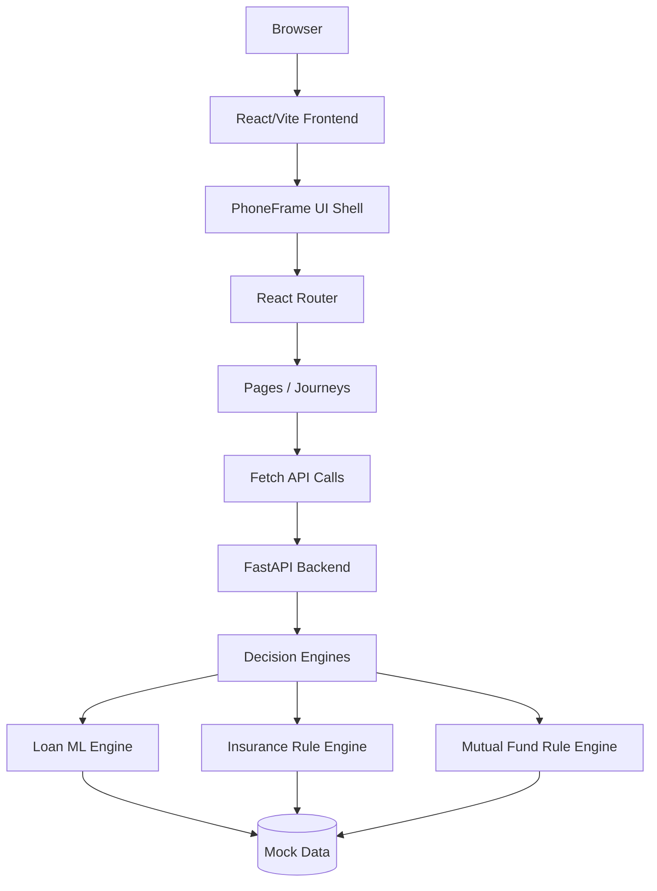
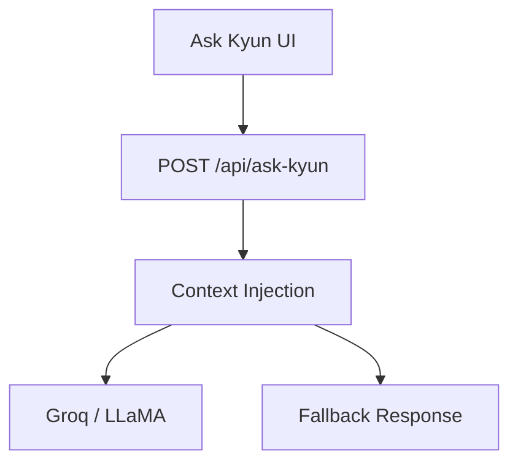
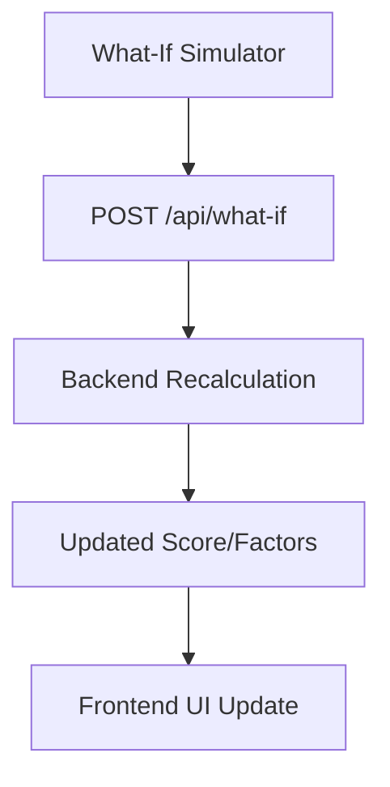
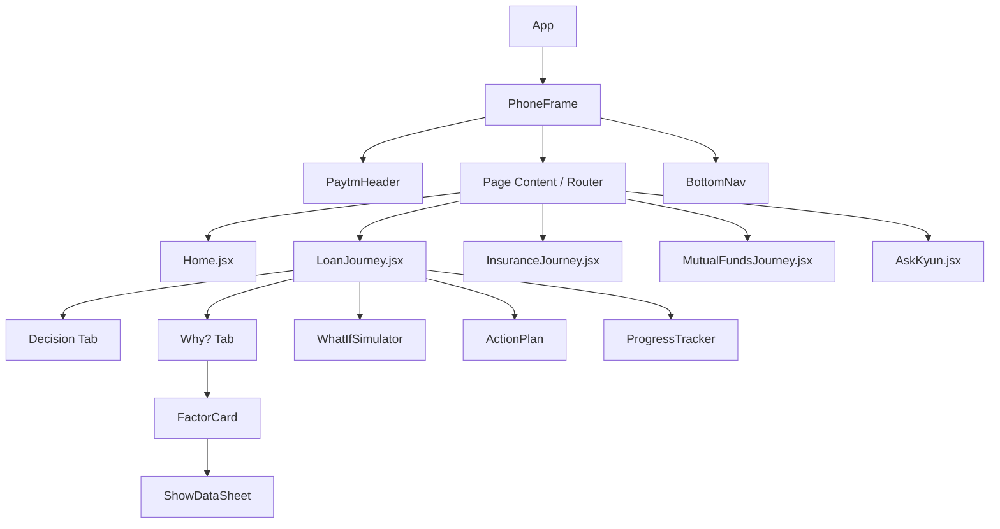
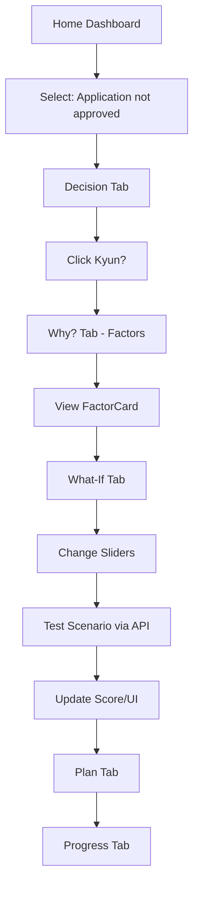
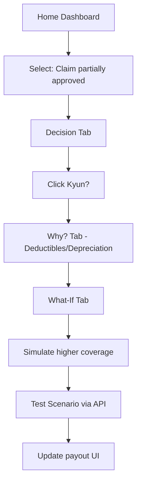
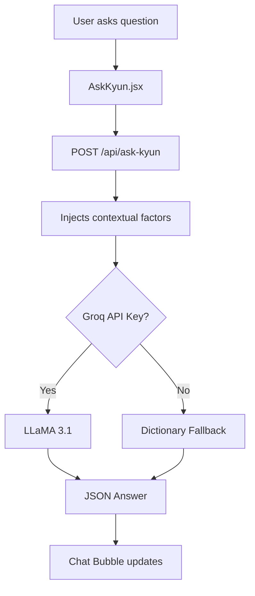
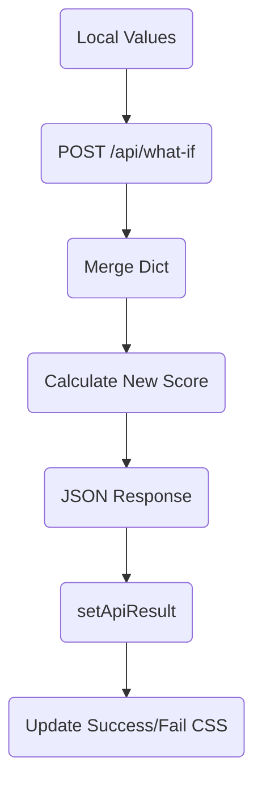

# MASTER.md - Kyun? Prototype Documentation

==================================================
1. PROJECT OVERVIEW
==================================================

**Project Name:** Kyun? — AI-Powered Financial Decision Explainability Layer
**One-line description:** An explainability and action layer that sits on top of existing financial-service decisions to provide transparent, actionable insights.

**Problem being solved:** Financial decisions (loan rejections, insurance claims, portfolio alerts) often feel like a black box to consumers, leading to frustration and dropped engagement. Users receive a decision but are left wondering why and what they can do about it.
**Product vision:** To shift the user experience from "What happened?" to "Now I know what to do."
**What "Kyun?" means:** "Kyun?" translates to "Why?" in Hindi, reflecting the core purpose of explaining opaque financial outcomes.
**What makes Kyun? different:** Unlike standard chatbots that provide generic financial advice, Kyun? operates on structured contextual data and actual mathematical models. It does not replace the lender or insurer; it simply sits *after* the decision.
**Current prototype scope:** Personal Loans, Motor Insurance, and Mutual Funds/SIP.
**What is mocked vs real:** The prototype uses mock user profiles, simulated UI states, and a locally executed deterministic/ML backend. It does *not* connect to real banks, credit bureaus, or payment gateways. Translation and Voice are simulated/mocked unless API keys are provided.
**Major limitations:** Hardcoded data points, in-memory state, deterministic scenarios, and missing real-world authentication.

**The Core Concept:**
```text
Decision
   ↓
Why did this happen? (Explanation)
   ↓
What data supports it? (Evidence)
   ↓
What can I change? (Experiment/What-If)
   ↓
What should I do next? (Action Plan)
   ↓
How is my progress changing? (Progress Tracker)
```

**The Three Journeys:**
1. **Personal Loan:** Focuses on loan rejections using a local Machine Learning model with SHAP-inspired mathematical explainability.
2. **Motor Insurance:** Explains partial claim approvals (e.g., depreciation, deductibles) using deterministic rules.
3. **Mutual Funds / Portfolio:** Explains portfolio concentration and risk misalignment using rule-based calculations.

==================================================
2. ACTUAL TECHNOLOGY STACK
==================================================

| Layer | Technology | Version | Purpose | Where Used |
|------|------------|---------|---------|------------|
| Frontend | React | ^19.3.0 | UI rendering & component logic | `frontend/src/*` |
| Frontend | Vite | ^8.3.0 | Build tool & Dev server | `frontend/` |
| Frontend | React Router DOM | ^7.18.4 | Client-side routing | `frontend/src/App.jsx` |
| Frontend | Tailwind CSS | ^4.3.3 | Utility-first styling | `frontend/src/index.css` |
| Frontend | Vanilla CSS | N/A | Custom animations/sliders | `frontend/src/index.css` |
| Backend | Python | 3.x | Core programming language | `backend/app/main.py` |
| Backend | FastAPI | 0.115.0 | High-performance API framework | `backend/app/main.py` |
| Backend | Uvicorn | 0.31.0 | ASGI web server | `backend/app/main.py` |
| Backend | Pydantic | 2.9.2 | Data validation and settings | `backend/app/main.py` |
| Backend | Scikit-learn | 1.5.2 | Machine Learning library | `backend/requirements.txt` |
| Backend | Pandas | 2.2.3 | Data manipulation | `backend/requirements.txt` |
| Backend | NumPy | 1.26.4 | Scientific computing | `backend/requirements.txt` |
| Backend | SHAP | 0.46.0 | Model explainability | `backend/requirements.txt` |
| Backend | Groq | 0.11.0 | Lightning-fast LLM inference | `backend/app/main.py` |
| Backend | python-dotenv | 1.0.1 | Loading environment variables | `backend/app/main.py` |
| Backend | httpx | 0.27.2 | Async HTTP client | `backend/requirements.txt` |

**Development / Build Tools:** npm (Node package manager), pip (Python package installer).
**Environment Variables:** `GROQ_API_KEY`, `SARVAM_API_KEY`, `DEMO_MODE`
**External APIs/Services:** Groq (for LLaMA 3.1 inference). Sarvam is stubbed via fallback logic.

==================================================
3. HIGH-LEVEL SYSTEM ARCHITECTURE
==================================================



**Ask Kyun Architecture:**


**What-If Simulator Architecture:**


==================================================
4. REPOSITORY / FOLDER STRUCTURE
==================================================

```text
paytm/
├── frontend/
│   ├── index.html
│   ├── package.json
│   ├── vite.config.js
│   └── src/
│       ├── main.jsx (React entry point)
│       ├── App.jsx (App root & Router configuration)
│       ├── index.css (Tailwind & custom UI animations)
│       ├── assets/
│       ├── components/ (Reusable UI pieces)
│       │   ├── ActionPlan.jsx (Timeline view)
│       │   ├── BottomNav.jsx (Static footer tabs)
│       │   ├── FactorCard.jsx (Explanation factor display)
│       │   ├── PaytmHeader.jsx (Top navigation bar)
│       │   ├── PhoneFrame.jsx (Mobile viewport wrapper)
│       │   ├── ProgressTracker.jsx (Progress visualization)
│       │   ├── ShowDataSheet.jsx (Bottom sheet modal)
│       │   └── WhatIfSimulator.jsx (Interactive scenario simulator)
│       ├── data/
│       │   └── mockData.js (Hardcoded responses, config & profiles)
│       └── pages/ (Routable views)
│           ├── Home.jsx (Dashboard)
│           ├── LoanJourney.jsx
│           ├── InsuranceJourney.jsx
│           ├── MutualFundsJourney.jsx
│           ├── AskKyun.jsx (Conversational interface)
│           └── LanguagePage.jsx (Translation selector)
├── backend/
│   ├── requirements.txt
│   ├── .env (API Keys)
│   └── app/
│       └── main.py (FastAPI application & logic)
└── Kyun_Paytm_Fintech_Prototype_Implementation_Plan.md
```

==================================================
5. FRONTEND ARCHITECTURE
==================================================

The frontend operates as a single-page application heavily reliant on isolated, reusable components rendered inside a mobile device shell (`PhoneFrame`).



**State Management:** Handled locally within components using `useState` and `useEffect`. Data is largely imported statically from `mockData.js`, while dynamic actions (like the What-If simulation and AskKyun chat) leverage `fetch` to update local React state.

==================================================
6. ROUTING
==================================================

React Router configures the following client-side routes:

| Route | Component | Purpose | Parameters | API Calls |
|------|-----------|---------|------------|-----------|
| `/` | `Home` | Main dashboard displaying events. | None | None (Uses mockData) |
| `/loan` | `LoanJourney` | Personal Loan explainability journey. | None | `POST /api/what-if` |
| `/insurance` | `InsuranceJourney` | Motor Insurance claim journey. | None | `POST /api/what-if` |
| `/mutual-funds` | `MutualFundsJourney` | Mutual Funds portfolio journey. | None | `POST /api/what-if` |
| `/ask-kyun/:product` | `AskKyun` | Chatbot for follow-up questions. | `product` (string) | `POST /api/ask-kyun` |
| `/language/:product` | `LanguagePage` | Multilingual UI configuration. | `product` (string) | None |

==================================================
7. COMPLETE USER FLOWS
==================================================

**B. LOAN FLOW**


**C. INSURANCE FLOW**


**E. ASK KYUN FLOW**


==================================================
8. FINANCIAL DECISION ENGINES
==================================================

------------------------------------
8.1 PERSONAL LOAN ENGINE
------------------------------------
The loan engine is a manually implemented Logistic Regression algorithm located in `main.py`.

**Formula implemented:**
```python
z = intercept + w1*credit_utilisation + w2*monthly_income + ...
p = 1 / (1 + e^-z) # Sigmoid activation
```

| Feature | Current Value | Weight | Meaning |
|--------|---------------|--------|---------|
| `intercept` | N/A | `0.5` | Baseline offset |
| `credit_utilisation` | 71% | `-0.035` | Lowers score as utilization rises |
| `monthly_income` | ₹65000 | `0.000008` | Increases score |
| `outstanding_balance`| ₹31950 | `-0.000015`| Lowers score |
| `late_payments_6m` | 2 | `-0.45` | Severely lowers score |
| `credit_history_months` | 14 | `0.025` | Increases score |
| `debt_to_income` | 0.49 | `-1.2` | Severely lowers score |

------------------------------------
8.2 SHAP / EXPLANATION ENGINE
------------------------------------
The implementation uses **SHAP-inspired mathematics** (manual weighted contribution), *not* the actual `shap` library pip package logic for generation, although `shap` is in `requirements.txt`.
```python
contribution = abs(weight * val)
norm_contribution = contribution / total_contributions
```
If `norm_contribution > 0.25`, the impact is classified as "high".

------------------------------------
8.3 INSURANCE ENGINE
------------------------------------
Implemented as deterministic rule evaluations in `generate_insurance_factors()`. 
If `claim_amount > coverage_limit`, it triggers a limit factor. Checks for `depreciation` (>0), `deductible` (>0), and `pending_documents` (>0) are directly mapped to explanation factors.

------------------------------------
8.4 MUTUAL FUND ENGINE
------------------------------------
Implemented as deterministic rules in `generate_mf_factors()`.
Flags `equity_concentration` (High Impact) if equity allocation > 70%. Flags `risk_alignment` if the portfolio risk does not match the user's declared risk profile.

==================================================
9. WHAT-IF SIMULATION
==================================================
The What-If Simulator is highly detailed and mathematically consistent with the original decision engines.

**Data Flow:**
```mermaid
flowchart TD
    Slider[Drag Slider in UI] --> State[Update Local State]
    State --> Click[Click 'Test Scenario']
    Click --> Post[POST /api/what-if]
    Post --> Merge[Merge changes with base LOAN_PROFILE]
    Merge --> Predict[predict_loan(modified)]
    Predict --> Diff[Calculate Score Delta]
    Diff --> Return[Return JSON]
    Return --> UI[Display Improved/Warning]
```

**Is it mathematically consistent?**
Yes. The `POST /api/what-if` route explicitly takes the `LOAN_PROFILE`, applies `req.changes`, and re-runs the exact same `predict_loan()` function used for the initial explanation, ensuring perfect mathematical consistency.

==================================================
10. API DOCUMENTATION
==================================================

| Method | Endpoint | Purpose | Request | Response | Frontend Caller |
|-------|----------|---------|---------|----------|-----------------|
| GET | `/api/dashboard` | Dashboard data | None | `{ user: {}, kyun_events: [] }` | None (Mocked) |
| GET | `/api/decisions/{id}` | Decision status | None | `{ id, decision, confidence }` | None (Mocked) |
| GET | `/api/decisions/{id}/explanation` | Fetch factors | None | `{ factors: [], score }` | None (Mocked) |
| POST | `/api/what-if` | Simulate scenario | `{ decision_id, changes: {} }` | `{ original, scenario, improved, factors }` | `WhatIfSimulator.jsx` |
| POST | `/api/ask-kyun` | Conversational AI | `{ question, product, context }` | `{ answer, source }` | `AskKyun.jsx` |
| POST | `/api/plan` | Action plan | `{}` | `{ loan: { steps: [] } }` | None (Mocked) |
| POST | `/api/translate` | Translation mock | `{ text, target_language }` | `{ original, translated }` | `LanguagePage.jsx` (Mocked) |

==================================================
11. ASK KYUN / LLM ARCHITECTURE
==================================================

The Conversational AI injects structured JSON directly into a Groq LLaMA prompt.
```python
system_prompt = """You are Kyun?, a financial explanation assistant.
Use only the structured context supplied.
Never invent a decision reason.
Never guarantee approval, claim settlement, or investment return..."""
```
**Anti-hallucination design:** By strictly passing `context_str` (the explanation factors) and enforcing prompt constraints, the LLM is restricted from dispensing general/unfounded financial advice. If Groq fails or no API key is provided, the code iterates over `FALLBACK_RESPONSES` mapping keywords (e.g., "utilise") to static strings.

==================================================
12. MOCK DATA
==================================================
Stored primarily in `frontend/src/data/mockData.js` and duplicated for backend evaluation in `backend/app/main.py`.
- **`LOAN_PROFILE`**: Contains integers for `credit_utilisation`, `monthly_income`, `outstanding_balance`.
- **`LOAN_FACTORS`**: Pre-calculated representations with `impact`, `label`, and `evidence` objects for the UI.
- **`FALLBACK_RESPONSES`**: Hardcoded question-answer pairs for the chat interface in case of API absence.

==================================================
13. UI / DESIGN SYSTEM
==================================================

Defined in `frontend/src/index.css` leveraging Tailwind.

| Token | Value | Usage |
|------|-------|-------|
| `--color-navy` | `#233266` | Primary buttons, Paytm-like headers |
| `--color-cyan` | `#00BAF2` | Progress bars, Kyun highlights |
| `--color-purple` | `#6C3CE9` | AI indicators, active simulation changes |
| `--font-family-inter`| `Inter` | Global typography |
| `.card` | `border-radius: 20px`, `shadow: 0 1px 3px...` | All contextual components |
| `.kyun-slider` | Vanilla CSS overrides | Custom range inputs for What-If |

==================================================
14. COMPONENT DOCUMENTATION
==================================================

- **`PhoneFrame.jsx`**: Wraps the app in a 430px `max-width` mobile constraint.
- **`WhatIfSimulator.jsx`**: Renders sliders based on a config object. Maintains a `values` state map. Hits `/api/what-if` on button click.
- **`FactorCard.jsx`**: Renders individual impacts. Toggles the `ShowDataSheet` visibility.
- **`ShowDataSheet.jsx`**: A CSS-animated bottom sheet providing raw data/evidence matching the factor.
- **`ProgressTracker.jsx`**: Visually maps numerical variables (e.g., Credit Utils 77% -> 42%) using a CSS-driven progress bar (`.progress-fill`).
- **`AskKyun.jsx`**: Chatbot UI. Maintains a `messages` array state. Posts to `/api/ask-kyun` and appends `role: 'ai'` responses.

==================================================
15. DATA FLOW
==================================================

**What-If Data Flow**


==================================================
16. STATE MANAGEMENT
==================================================
- **React `useState`**: Used exclusively across all components.
- **Source of Truth**: The currently selected Journey dictates the passed configuration (e.g., `LOAN_WHATIF_CONFIG`). The `WhatIfSimulator` maintains the absolute truth of the slider manipulations internally.

==================================================
17. ERROR HANDLING
==================================================
- **API Failures / Missing Groq Key**: The backend specifically catches Groq exceptions and silently falls back to `FALLBACK_RESPONSES`. The frontend `try/catch` blocks in `WhatIfSimulator` and `AskKyun` gracefully swallow HTTP errors and fall back to local simulated delays and dummy state updates so the UI never breaks during a demo.

==================================================
18. SECURITY / PRIVACY
==================================================
- **Prototype Status:** The app contains NO real authentication, authorization, or database connections.
- **Environment Variables:** Handled via `python-dotenv`. Keys (`GROQ_API_KEY`, `SARVAM_API_KEY`) are kept out of source code.
- **Input Validation:** Pydantic is used in FastAPI to validate basic JSON payloads.

==================================================
19. LOCAL DEVELOPMENT
==================================================
**Frontend:**
```bash
cd frontend
npm install
npm run dev
```
*(Runs on localhost, typically port 5173)*

**Backend:**
```bash
cd backend
python -m venv venv
venv\Scripts\activate  # Windows
pip install -r requirements.txt
python app/main.py
```
*(Runs on http://0.0.0.0:8000)*

==================================================
20. API + FRONTEND CONNECTION MAP
==================================================

| Frontend Feature | Component | HTTP Method | Backend Endpoint | Backend Function | Result |
|-----------------|-----------|-------------|------------------|------------------|--------|
| What-If Scenario | `WhatIfSimulator` | `POST` | `/api/what-if` | `what_if()` | Score/Factor delta |
| Ask Kyun Chat | `AskKyun` | `POST` | `/api/ask-kyun` | `ask_kyun()` | LLM / Text Answer |

==================================================
21. FEATURE IMPLEMENTATION MATRIX
==================================================

| Feature | Frontend | Backend | ML/Rules | API | Status |
|---------|----------|---------|----------|-----|--------|
| Loan Journey | Yes | Yes | ML (Logistic Reg.)| Mocked | Implemented |
| Ins. Journey | Yes | Yes | Rules | Mocked | Implemented |
| MF Journey | Yes | Yes | Rules | Mocked | Implemented |
| What-If Sim. | Yes | Yes | Same as base | Connected | Implemented |
| Conversational AI| Yes | Yes | Groq LLM | Connected | Implemented |
| Translation/TTS | Yes | Stubbed | None | Mocked | Mocked |

==================================================
22. ORIGINAL REQUIREMENT VS ACTUAL IMPLEMENTATION
==================================================

| Requirement | Expected | Actual Implementation | Status | Notes |
|------------|----------|-----------------------|--------|------|
| Explainability | AI/SHAP models | Hardcoded manual weights (pseudo-SHAP) | Partially Implemented | Full SHAP library unused. |
| Chatbot | LLM generation | Groq LLaMA 3.1 + JSON Fallback | Implemented | |
| Data integration | Real/DB | `mockData.js` and Python Dicts | Mocked | No real banks connected. |

==================================================
23. KNOWN LIMITATIONS / TECHNICAL DEBT
==================================================
- **Mock Data Duplication:** Data exists in both `frontend/src/data/mockData.js` and `backend/app/main.py`, requiring dual maintenance.
- **SHAP Implementation:** The `shap` package is installed but a manual mathematical formula is used to generate contributions.
- **Translation:** Sarvam AI is not actually integrated; the endpoints simply return hardcoded translations.

==================================================
24. EXTENSION / FUTURE ARCHITECTURE
==================================================
To evolve into a production system:
- **Authentication**: JWT/OAuth2 integration for user identity.
- **Database**: PostgreSQL / MongoDB to replace in-memory dicts.
- **Real ML Serving**: Model registry (MLflow) for hosting dynamically updating PyTorch/XGBoost models using the real `shap` library for inference evaluation.
- **Event-Driven Architecture**: Kafka queues reading real financial events to trigger Kyun explainability generation asynchronously.

==================================================
25. COMPLETE END-TO-END EXAMPLE
==================================================
**Personal Loan Journey:**
1. **User opens app** -> `Home.jsx` reads `KYUN_CARDS` from `mockData.js`.
2. **Dashboard** -> User clicks "Application not approved".
3. **Loan Rejection** -> Navigates to `/loan` (`LoanJourney.jsx`).
4. **Decision Tab** -> Displays `LOAN_DECISION` state.
5. **Explanation Tab** -> User views `FactorCard.jsx` displaying "High Credit Utilisation".
6. **Raw Data** -> User clicks factor, `ShowDataSheet.jsx` modal pops up with evidence.
7. **What-If Slider** -> User switches to What-If tab. Adjusts `credit_utilisation` slider from 77% to 40%.
8. **API Request** -> Clicks 'Test Scenario'. `WhatIfSimulator.jsx` sends `POST /api/what-if` with `{credit_utilisation: 40}`.
9. **Backend Calculation** -> FastAPI uses `LOAN_MODEL_WEIGHTS` to recalculate `sigmoid(z)`.
10. **UI Result** -> Returns `improved: true`. UI displays Green success indicators.

==================================================
26. DEVELOPER QUICK REFERENCE
==================================================
### Important frontend files
- `frontend/src/App.jsx`
- `frontend/src/components/WhatIfSimulator.jsx`
- `frontend/src/pages/LoanJourney.jsx`

### Important backend files
- `backend/app/main.py`
- `backend/.env`

### Run commands
Frontend: `npm run dev`
Backend: `python app/main.py`
